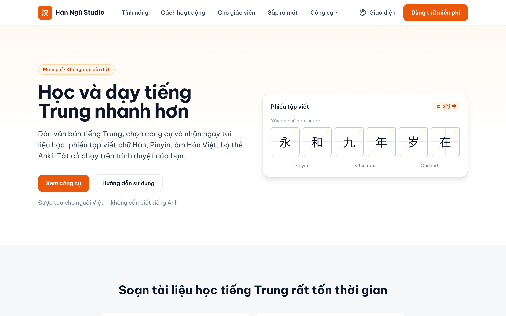
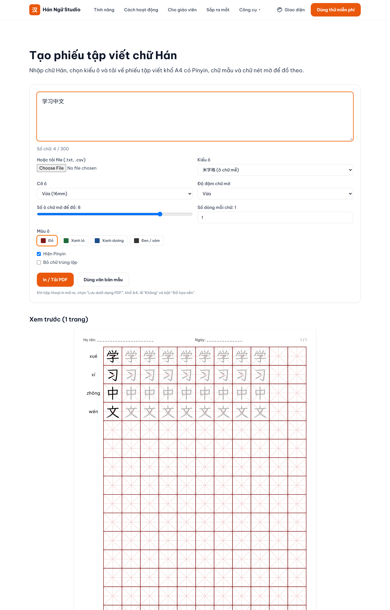
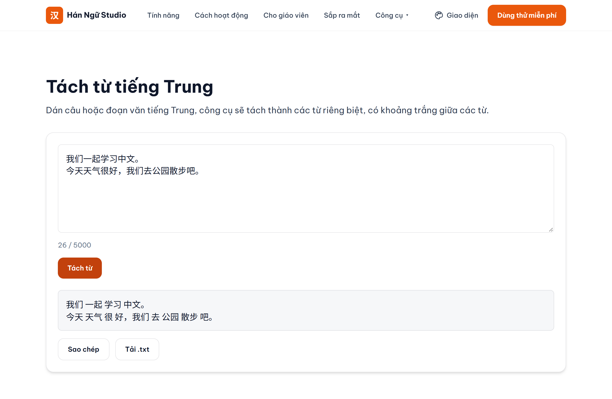
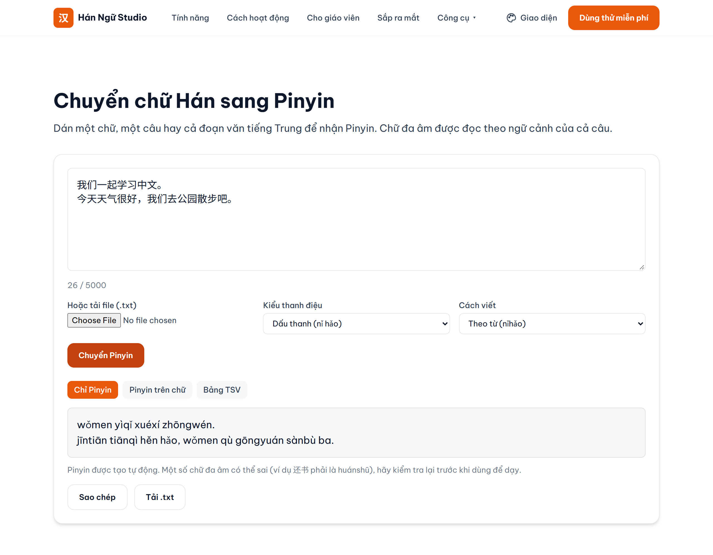
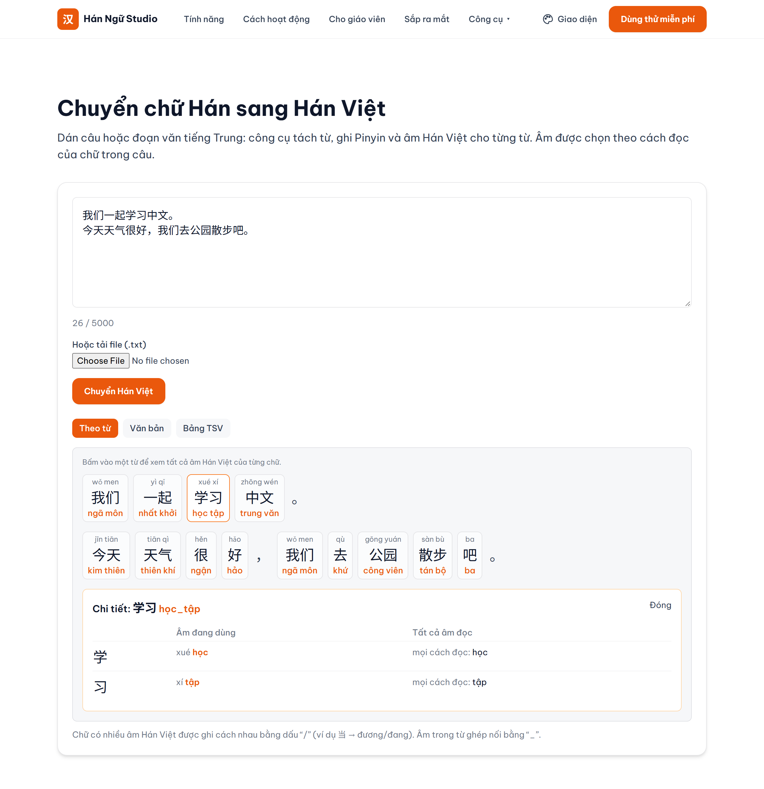
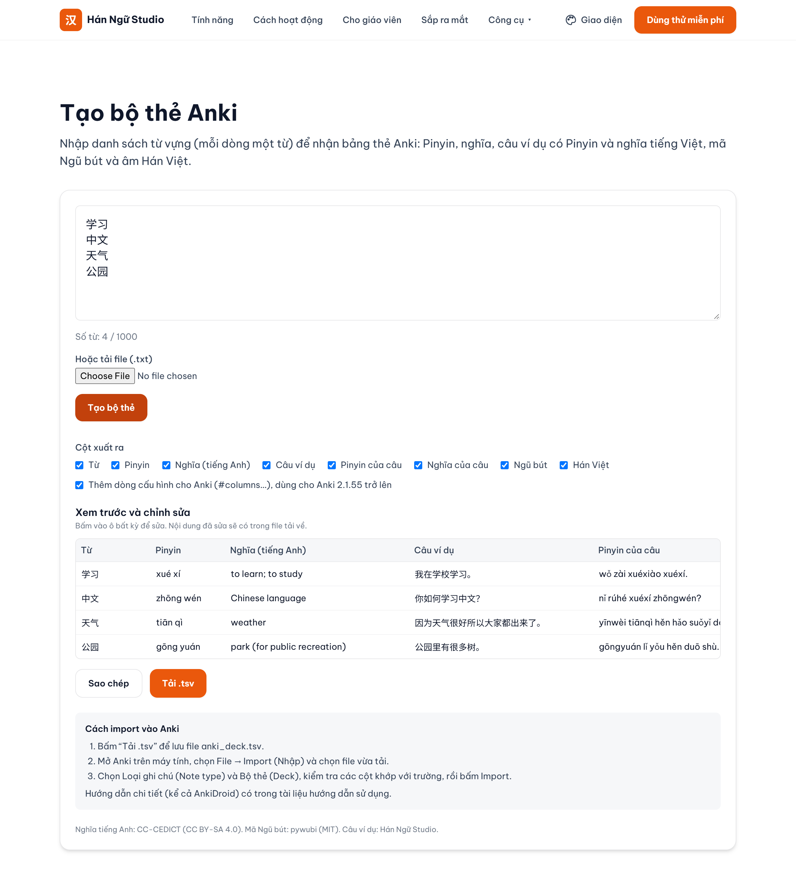
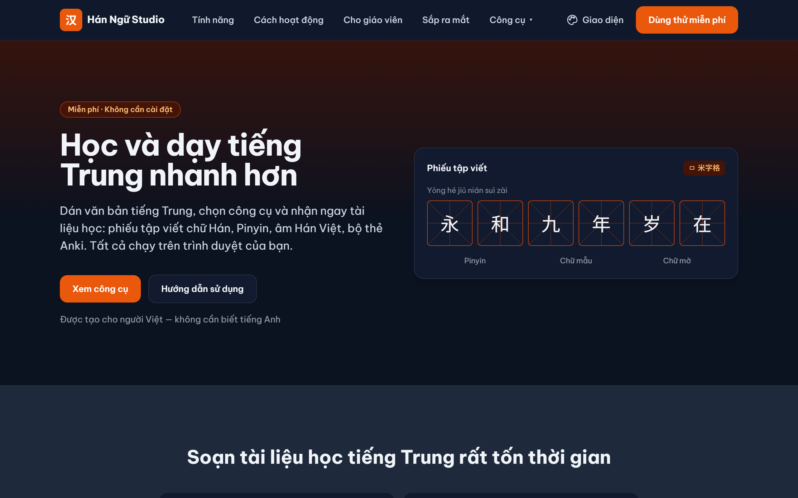

# Hán Ngữ Studio — Web

Free web tools for Vietnamese learners & teachers of Chinese. Everything runs in your browser; your text is never sent anywhere.
Built with **Next.js (App Router) + TypeScript + Tailwind CSS**. Deploys free on **Vercel**.

**Live site:** https://han-ngu-studio.vercel.app/



## Status

- ✅ Phase 1 — Landing page (this pass)
- ✅ Phase 2 — Practice-sheet generator (`/tools/practice-sheet`, rendered in the browser, print to PDF)
- ✅ Word segmentation (`/tools/segment`, runs in the browser)
- ✅ Pinyin converter (`/tools/pinyin`, runs in the browser)
- ✅ Hán Việt (`/tools/hanviet`, runs in the browser)
- ✅ Anki deck generator (`/tools/anki`, TSV export)
- ✅ N+1 sentence ordering (`/tools/comprehensible-input`)
- ⏳ Anki images, TTS: see [`docs/plans/2026-10-15-roadmap.md`](docs/plans/2026-10-15-roadmap.md)
- ✅ English site (`/en`), Traditional characters, reader, pronunciation

## Screenshots

### [Practice sheet](https://han-ngu-studio.vercel.app/tools/practice-sheet) (米字格 grid, Pinyin, traceable characters → PDF)



### [Word segmentation](https://han-ngu-studio.vercel.app/tools/segment)



### [Pinyin converter](https://han-ngu-studio.vercel.app/tools/pinyin)



### [Hán Việt](https://han-ngu-studio.vercel.app/tools/hanviet) (per-word readings + details panel)



### [Anki deck generator](https://han-ngu-studio.vercel.app/tools/anki) (Pinyin, meaning, example, Wubi, Hán Việt → TSV)



### Dark mode



## User guide

How to use each tool (Vietnamese): [`userguide/`](userguide/README.md).

## Local development

```bash
pnpm install
pnpm dev
# open http://localhost:3000
pnpm test  # Vitest (golden tests)
```

## Build

```bash
pnpm build
pnpm start
```

## Deploy to Vercel (free)

1. Push this repo to GitHub.
2. Go to https://vercel.com → **New Project** → import the repo.
3. Framework preset auto-detects **Next.js**. Click **Deploy**.
4. You get a free `*.vercel.app` URL. Add a custom domain later if you want.

## Structure

```
.
├─ app/
│  ├─ layout.tsx            # root layout, fonts, metadata
│  ├─ page.tsx              # landing page composition
│  ├─ tools/practice-sheet/ # 米字格/田字格 practice-sheet generator
│  ├─ tools/segment/        # word segmentation
│  ├─ tools/pinyin/         # Pinyin converter
│  ├─ tools/hanviet/        # Hán Việt readings
│  ├─ tools/anki/           # Anki deck generator (TSV)
│  └─ globals.css           # theme tokens (light/dark, accents)
├─ components/              # landing sections (Hero, Features, Roadmap, FAQ, …) + tool UI
├─ lib/
│  ├─ practiceSheet.ts      # character parsing, pagination, pinyin
│  ├─ segment/ pinyin/ hanviet/ anki/   # pure tool logic + golden tests
│  └─ i18n/                 # Vietnamese copy (English-ready)
├─ public/data/             # static data (word list, Hán Việt, meanings, Wubi…), lazy-loaded
├─ assets/dictionary/       # raw source data
├─ scripts/build-data.mjs   # assets/dictionary → public/data (`pnpm build:data`)
├─ docs/                    # plans, README screenshots
└─ userguide/               # end-user guide (Vietnamese)
```

## Internationalization

All copy lives in `lib/i18n/vi.ts`. To add English:

1. Copy `vi.ts` → `en.ts` and translate.
2. Register it in `lib/i18n/index.ts` (`en: en`).
3. Later, add a locale switcher / `next-intl` for routing (`/en`).

## Fonts

- **Be Vietnam Pro** — UI text (full Vietnamese diacritics).
- **Noto Sans SC** — Chinese glyphs (`.hanzi` class).
- **Noto Serif SC** — default practice-sheet font (Song/printed style, `--font-noto-serif-sc`).
- **LXGW WenKai TC** — Kai-style practice-sheet font and the fallback for missing glyphs (`--font-kai`).

## Licence and credits

- **Code:** [MIT](LICENSE).
- **Data:** each dataset keeps its own licence (CC-CEDICT and CVDICT: CC BY-SA 4.0; Tatoeba: CC BY 2.0 FR; Make Me a Hanzi: LGPL-3.0+ / Arphic; audio-cmn: CC BY-SA; HSK 3.0 list: MIT…). See [THIRD-PARTY-NOTICES.md](THIRD-PARTY-NOTICES.md) and the site page [/giay-phep](https://han-ngu-studio.vercel.app/giay-phep).
