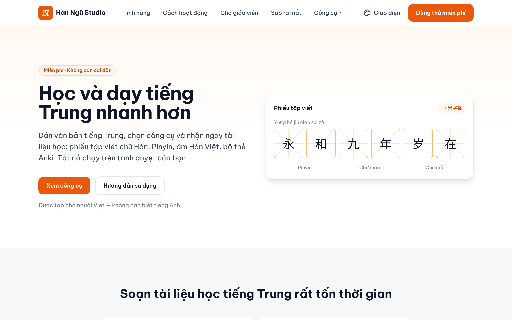
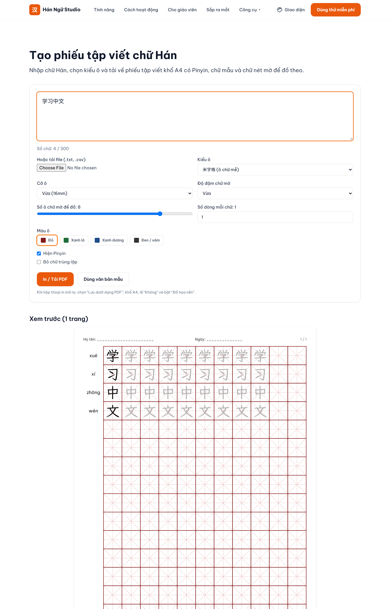
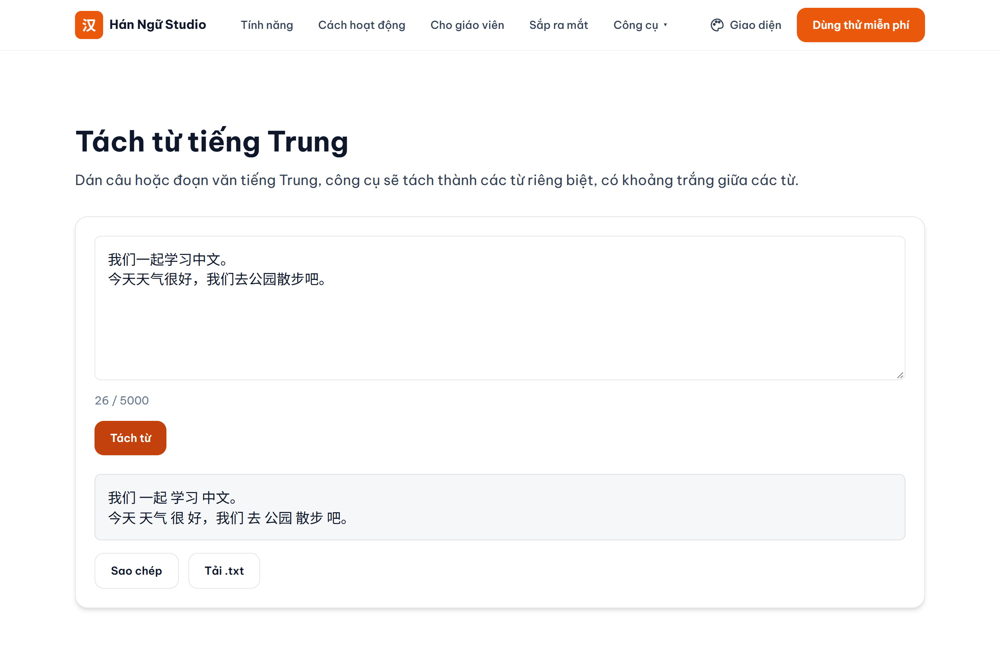
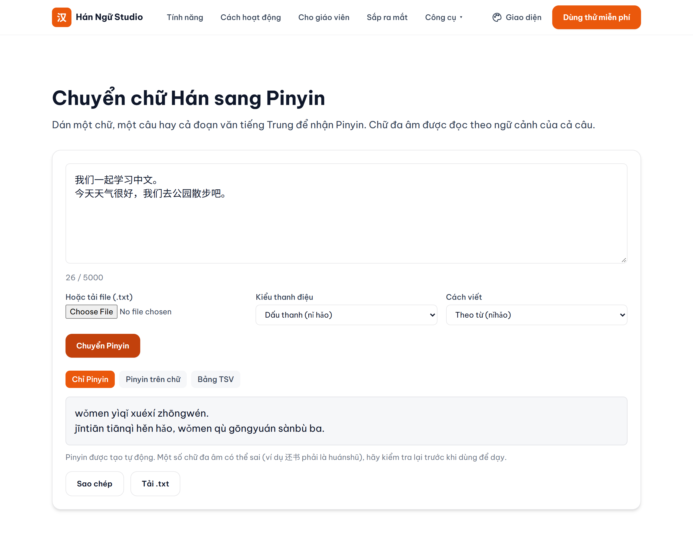
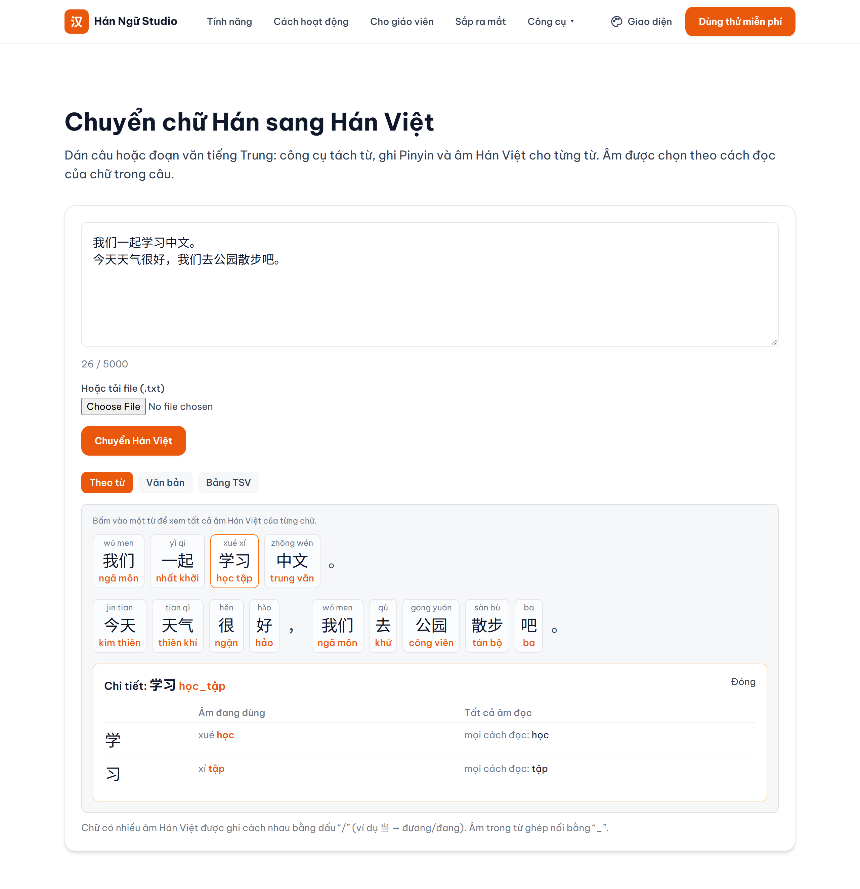
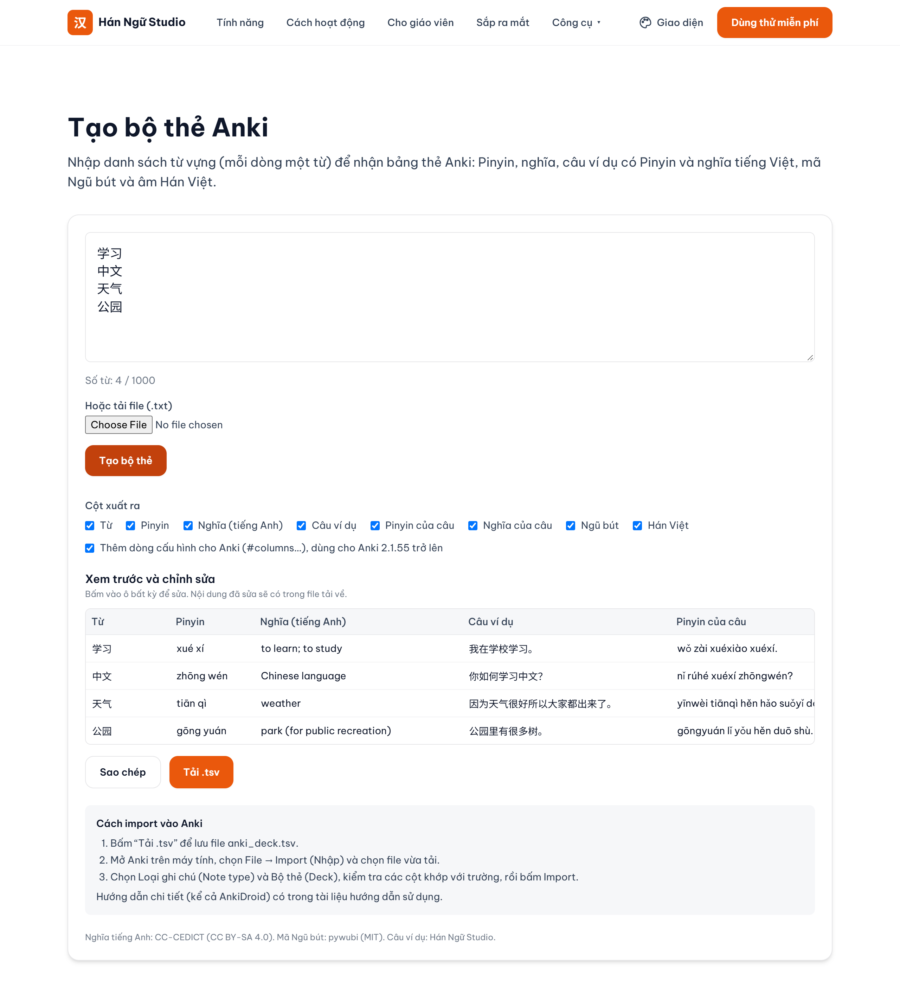
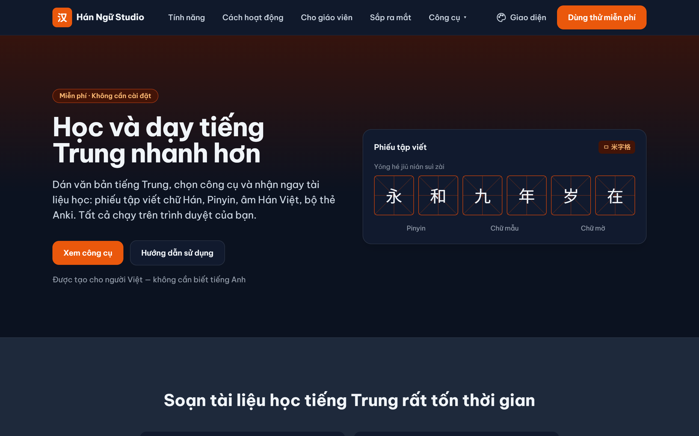

# Hán Ngữ Studio — Web

Free web tools for Vietnamese learners and teachers of Chinese. Everything runs in your browser: no account, no install, and your text is never sent anywhere.
Built with **Next.js 15 (App Router) + React 19 + TypeScript + Tailwind CSS**. Deploys on the free **Vercel Hobby** plan.

**Live site:** https://han-ngu-studio.vercel.app/ (Vietnamese) · https://han-ngu-studio.vercel.app/en (English)



## Tools

Fourteen tools in three groups, as on the site. Every tool follows the **Giản thể / Phồn thể** (Simplified / Traditional) switch in the navbar. Step-by-step guides in Vietnamese: [`userguide/`](userguide/README.md).

### Chữ Hán — one character at a time

| Tool | Route | What it does |
|---|---|---|
| Lộ trình 1000 chữ (Learning path) | [`/tools/lo-trinh`](https://han-ngu-studio.vercel.app/tools/lo-trinh) | The 1000 most common characters (every HSK 1–3 character included) in 10 stages, components before the characters built from them; tick what you have learned, make an Anki deck or practice sheet per stage |
| Thứ tự nét (Stroke order) | [`/tools/stroke-order`](https://han-ngu-studio.vercel.app/tools/stroke-order) | Stroke animation, step diagram, write-it-yourself quiz |
| Chiết tự (Character breakdown) | [`/tools/decompose`](https://han-ngu-studio.vercel.app/tools/decompose) | Component tree coloured on the glyph, semantic/phonetic parts, component families, **Giản · Phồn · Nhật** forms (Simplified · Traditional · Japanese shinjitai), old forms **through the ages** (oracle bone → bronze → seal, from Wikimedia Commons, public domain), suggested memory tricks labelled **Mẹo nhớ / Theo nguồn gốc**, your own notes, and a **"Tải ảnh thẻ chữ"** 1080×1350 PNG card to share |
| 214 bộ thủ (Radicals) | [`/tools/radicals`](https://han-ngu-studio.vercel.app/tools/radicals) | The 214 Kangxi radicals by stroke count, Hán Việt name or meaning, with variants and example characters |
| Phiếu tập viết (Practice sheet) | [`/tools/practice-sheet`](https://han-ngu-studio.vercel.app/tools/practice-sheet) | A4 米字格 / 田字格 sheets with Pinyin, model and traceable characters, stroke-order strip → print or PDF |

### Đọc văn bản — paste a sentence or a text

| Tool | Route | What it does |
|---|---|---|
| Đọc hiểu (Reader) | [`/tools/reader`](https://han-ngu-studio.vercel.app/tools/reader) | Words coloured by HSK level, tap a word for Pinyin / Hán Việt / meaning, difficulty estimate, known words, study list → Anki, quiz or practice sheet |
| Truyện đọc (Stories) | [`/tools/stories`](https://han-ngu-studio.vercel.app/tools/stories) | Short modern stories by HSK level with new words, sentence translations and culture notes |
| Chuyển Pinyin | [`/tools/pinyin`](https://han-ngu-studio.vercel.app/tools/pinyin) | Pinyin for whole lines, polyphones read in context, ruby view, TSV |
| Âm Hán Việt | [`/tools/hanviet`](https://han-ngu-studio.vercel.app/tools/hanviet) | Pinyin and Hán Việt per word, every reading of each character |
| Ngắt từ (Segmentation) | [`/tools/segment`](https://han-ngu-studio.vercel.app/tools/segment) | Splits Chinese text into words |

### Từ vựng & ôn tập — from your word list

| Tool | Route | What it does |
|---|---|---|
| Tra từ (Word lookup) | [`/tools/tra-tu`](https://han-ngu-studio.vercel.app/tools/tra-tu) | Pinyin, Hán Việt, HSK level, part of speech, Vietnamese senses, measure words, examples |
| Tạo thẻ Anki (Anki decks) | [`/tools/anki`](https://han-ngu-studio.vercel.app/tools/anki) | Pinyin, meanings, HSK level, 1–3 easy examples, Wubi, Hán Việt → ready-to-import **.apkg** or TSV; the .apkg carries **human voice recordings** and a **"Nghe" (listen) card** that plays the word with no typing, good for a phone; **add every word of an HSK level**, skipping words you marked known |
| Trắc nghiệm (Quiz) | [`/tools/quiz`](https://han-ngu-studio.vercel.app/tools/quiz) | Meaning, Pinyin, Hán Việt, cloze and sentence-order questions; play, print or TSV |
| Sắp xếp câu N+1 | [`/tools/comprehensible-input`](https://han-ngu-studio.vercel.app/tools/comprehensible-input) | Orders sentences so each adds about one new word, with a built-in sentence bank |

Also on the site: human-voice pronunciation (off until you turn it on), light/dark mode with colour accents, and a licence page at [`/giay-phep`](https://han-ngu-studio.vercel.app/giay-phep).

**What's next:** [`docs/plans/2026-10-15-roadmap.md`](docs/plans/2026-10-15-roadmap.md) (the landing page's "Sắp ra mắt" section follows it).

## Screenshots

### [Practice sheet](https://han-ngu-studio.vercel.app/tools/practice-sheet) (米字格 grid, Pinyin, traceable characters → PDF)



### [Word segmentation](https://han-ngu-studio.vercel.app/tools/segment)



### [Pinyin converter](https://han-ngu-studio.vercel.app/tools/pinyin)



### [Hán Việt](https://han-ngu-studio.vercel.app/tools/hanviet) (per-word readings + details panel)



### [Anki deck generator](https://han-ngu-studio.vercel.app/tools/anki)



### Dark mode



## Project rules (short version)

The full list is in [`CLAUDE.md`](CLAUDE.md).

1. **Vercel Hobby only**: no paid features.
2. **No backend, no database**: all processing runs in the browser; data is static JSON in `public/data/`, split and lazy-loaded.
3. **Correctness over speed.**
4. **User text is never stored or sent.** The only things kept are notes and known words the learner chooses to save, in their own browser (localStorage), with TSV export/import.
5. **Only licensed data**: every dataset is listed in [`THIRD-PARTY-NOTICES.md`](THIRD-PARTY-NOTICES.md) and on `/giay-phep`. Nothing scraped.

## Local development

```bash
pnpm install
pnpm dev          # http://localhost:3000
pnpm test         # Vitest, including golden tests
pnpm lint         # also runs inside `next build`, so a lint error fails the deploy
pnpm build        # must pass before a change counts as done
```

### Data scripts

| Command | What it does |
|---|---|
| `pnpm build:data` | Rebuild `public/data/*` from `assets/dictionary/` (run after changing source data; commit the output) |
| `pnpm build:vocab-source` | One-off: join the HSK 3.0 list and CVDICT into `assets/dictionary/` (pinned commits) |
| `pnpm fetch:ancient` | One-off: download the old glyph forms from Wikimedia Commons into `assets/ancient/` (then run `pnpm build:data`) |
| `pnpm build:audio` | One-off: pack the audio-cmn recordings into `public/data/audio/` (then run `pnpm build:data`) |

## Deploy

Every push to `main` deploys to Vercel automatically, so changes go through pull requests. To deploy your own copy: import the repo at https://vercel.com → **New Project**; the **Next.js** preset is detected; click **Deploy**.

## Structure

```
.
├─ app/
│  ├─ page.tsx               # landing page
│  ├─ tools/<tool>/          # one folder per tool (14 tools, see above)
│  ├─ en/                    # English twin of every page (/en/…)
│  ├─ giay-phep/             # data and licence page
│  └─ globals.css            # theme tokens (light/dark, accents, Phồn thể fonts)
├─ components/               # landing sections + tool UI (decompose/, reader/, anki-guide/, speech/, …)
├─ lib/                      # pure tool logic, one folder per tool, with tests
│  ├─ i18n/                  # all UI text: vi.ts and en.ts
│  ├─ script/                # Giản thể / Phồn thể conversion (OpenCC)
│  └─ data/                  # download-size prompt for large data
├─ public/data/              # static data, lazy-loaded (dictionaries, strokes, examples, audio, …)
├─ assets/dictionary/        # raw source data and licences
├─ scripts/                  # data build scripts (`pnpm build:*`)
├─ docs/plans/               # implementation plans and the roadmap
└─ userguide/                # end-user guide, one page per tool (Vietnamese)
```

## Languages

The site is in **Vietnamese** (plain paths) and **English** (`/en/…`). All UI text lives in `lib/i18n/vi.ts` and `lib/i18n/en.ts`; `en` is typed against `vi`, so a missing key fails the build. Every page has an `app/en/…` twin. Tool data (Hán Việt, Vietnamese meanings, sentence translations) is not translated.

## Fonts

All self-hosted with `next/font`, SIL Open Font License:

- **Be Vietnam Pro**: UI text (full Vietnamese diacritics).
- **Noto Sans SC / TC**: Chinese glyphs (`.hanzi`); TC in Phồn thể mode.
- **LXGW WenKai TC**: Kai-style practice-sheet font and fallback for missing glyphs.
- **Noto Serif SC / TC**, **Ma Shan Zheng**: extra practice-sheet fonts.

## Licence and credits

- **Code:** [MIT](LICENSE).
- **Data:** each dataset keeps its own licence (HSK 3.0 list via ivankra/hsk30: MIT; CC-CEDICT and CVDICT: CC BY-SA 4.0; Tatoeba: CC BY 2.0 FR; Make Me a Hanzi: LGPL-3.0+ / Arphic; Wikimedia Commons ancient characters: public domain / CC0; audio-cmn: CC BY-SA; OpenCC: Apache-2.0; Unihan: Unicode License…). See [THIRD-PARTY-NOTICES.md](THIRD-PARTY-NOTICES.md) and [/giay-phep](https://han-ngu-studio.vercel.app/giay-phep).
